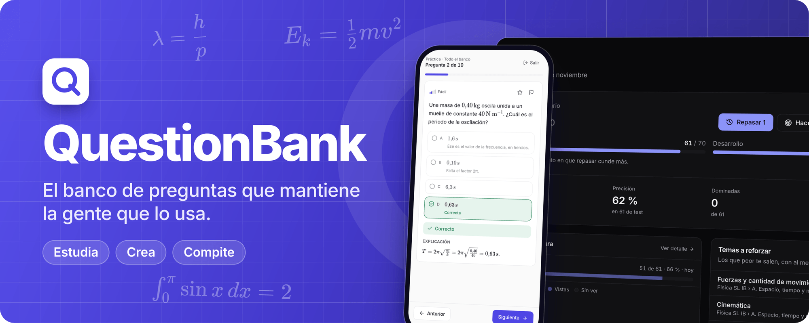
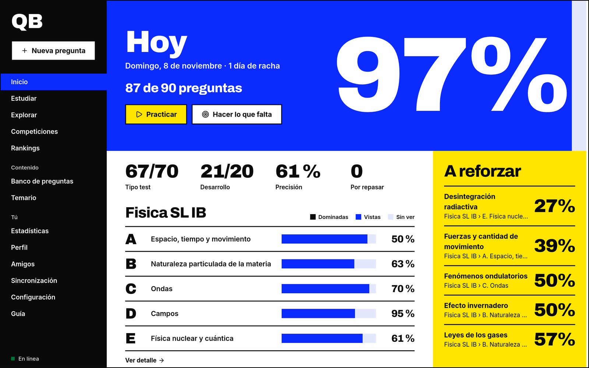
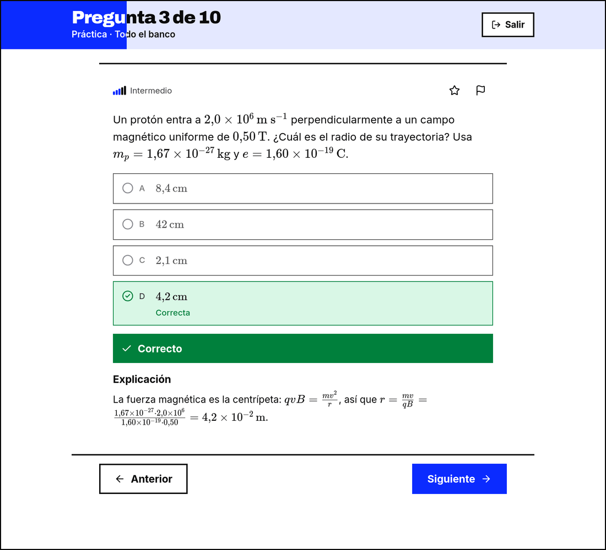
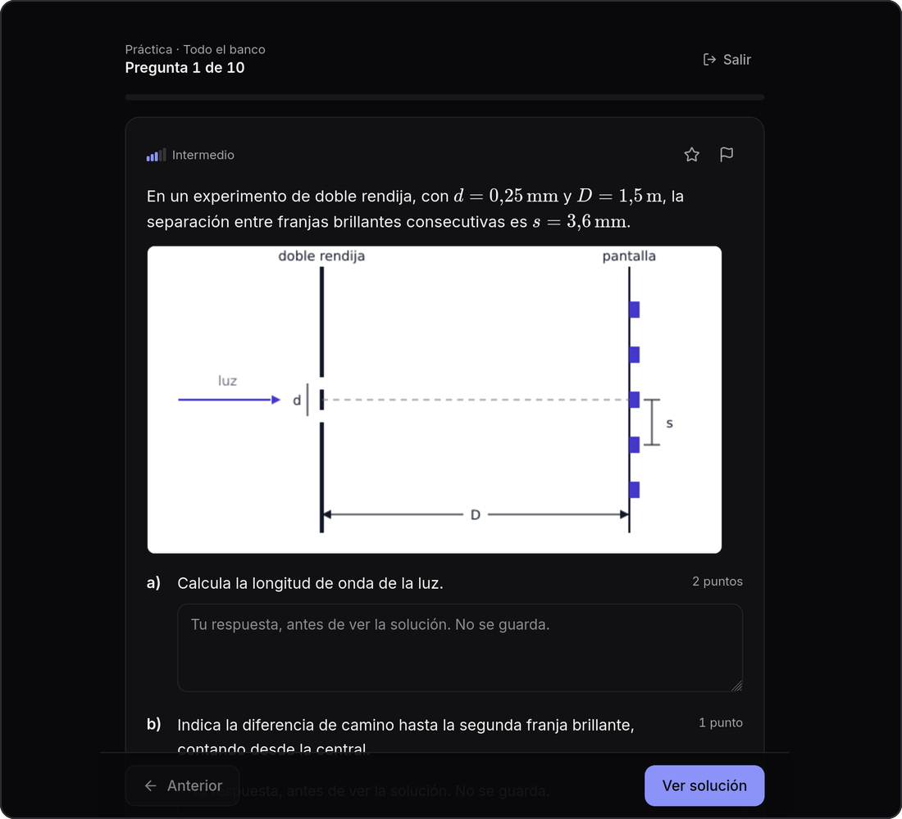
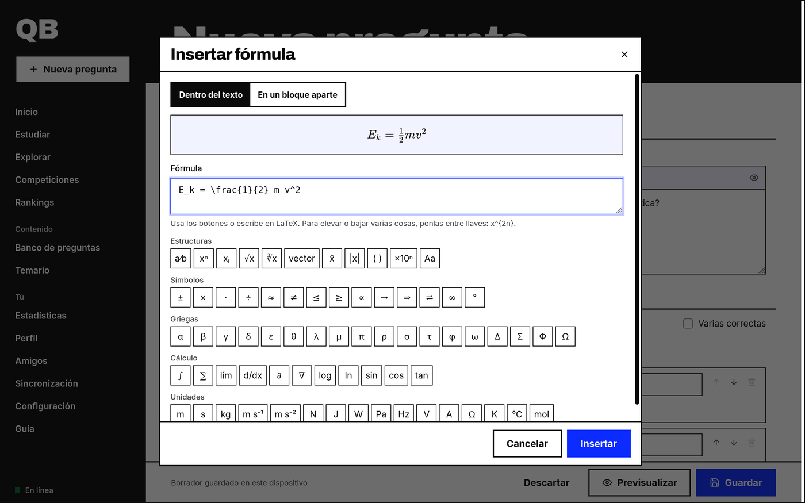
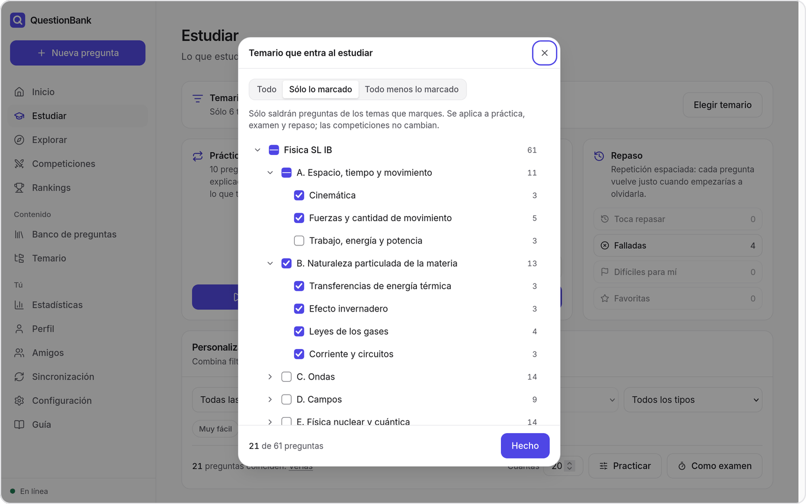
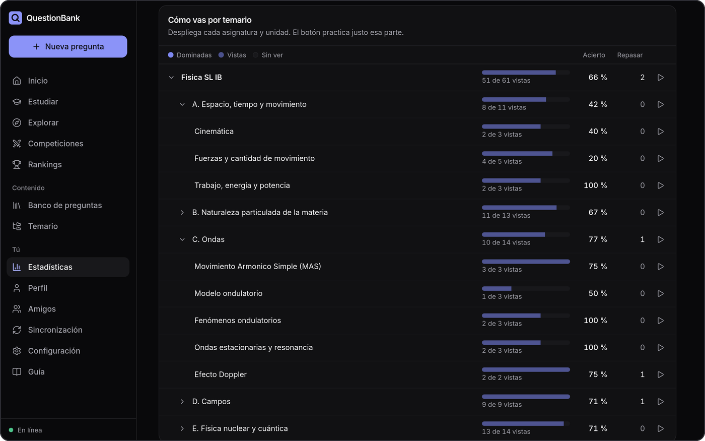
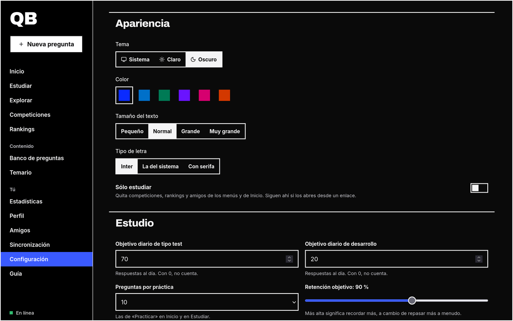
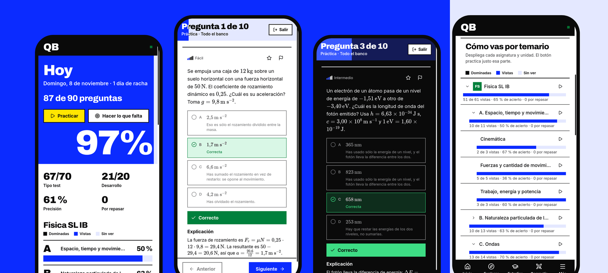
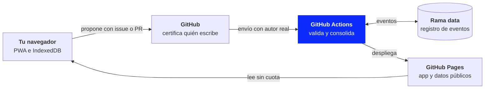

<div align="center">

<a href="https://tomasito25.github.io/QB-Bachillerato-Internacional/"></a>

**Crea preguntas con fórmulas e imágenes, repasa justo antes de olvidar y mira cómo vas tema a tema.**<br>
Funciona sin conexión y sin cuenta, y vive entero en GitHub: cero servidores propios, cero bases de datos.

<a href="https://tomasito25.github.io/QB-Bachillerato-Internacional/"></a>
<a href="docs/IMPORT.md"></a>
<a href="docs/ARCHITECTURE.md"></a>

<a href="https://github.com/Tomasito25/QB-Bachillerato-Internacional/actions/workflows/deploy.yml"></a>


[Funciones](#todo-para-estudiar-en-un-solo-sitio) · [Capturas](#así-se-ve) · [Cuenta](#empieza-sin-registrarte) · [Arquitectura](#cero-servidores-y-aun-así-colaborativo) · [Importar](#mete-cientos-de-preguntas-de-golpe) · [Desarrollo](#desarrollo-y-despliegue) · [Límites](#sin-letra-pequeña) · [Documentación](#documentación)

<br>

<picture>
  <source media="(prefers-color-scheme: dark)" srcset="docs/readme/hero-dark.png">
  
</picture>

</div>

## Todo para estudiar, en un solo sitio

<table>
<tr>
<td width="33%" valign="top">
<br>
<b>Repaso que se adapta</b><br>
Repetición espaciada con FSRS: cada pregunta vuelve justo cuando empezarías a olvidarla.
</td>
<td width="33%" valign="top">
<br>
<b>Exámenes con reloj</b><br>
Preguntas repartidas entre temas, con tiempo límite y sin ver las soluciones hasta entregar.
</td>
<td width="33%" valign="top">
<br>
<b>Tú eliges el temario</b><br>
Deja sólo unos temas o bloquea los que no te entren. Práctica, examen y repaso lo respetan.
</td>
</tr>
<tr>
<td valign="top">
<br>
<b>Fórmulas sin saber LaTeX</b><br>
Un asistente con estructuras, símbolos, griegas y unidades, con vista previa mientras escribes.
</td>
<td valign="top">
<br>
<b>Imágenes y apartados</b><br>
Test o desarrollo, con figuras, apartados y subapartados, cada uno con sus puntos.
</td>
<td valign="top">
<br>
<b>Importa en bloque</b><br>
Un solo JSON puede traer varias asignaturas, con sus temas y todas sus preguntas.
</td>
</tr>
<tr>
<td valign="top">
<br>
<b>Sabes cómo vas</b><br>
Avance, acierto y repasos pendientes por asignatura, unidad y tema. Un botón practica justo esa parte.
</td>
<td valign="top">
<br>
<b>Objetivo diario a medida</b><br>
Decide cuántas de test y cuántas de desarrollo, y «Hacer lo que falta» te prepara el resto.
</td>
<td valign="top">
<br>
<b>Sin conexión</b><br>
Se instala como una app y sigue funcionando sin internet. Tu progreso se queda en tu dispositivo.
</td>
</tr>
<tr>
<td valign="top">
<br>
<b>Compite</b><br>
Duelos, grupos, torneos y retos diarios o semanales. Añade amigos y compara cómo vais.
</td>
<td valign="top">
<br>
<b>Rankings auditables</b><br>
Nadie se escribe los puntos a mano: salen de un registro público de eventos validados.
</td>
<td valign="top">
<br>
<b>A tu gusto</b><br>
Tema claro u oscuro, seis colores, cuatro tamaños de texto y tres tipos de letra.
</td>
</tr>
</table>

## Así se ve

<table>
<tr>
<td width="50%" valign="top">
<br>
<b>Corrección al momento</b><br>
Con explicación, comentarios por opción y fórmulas bien escritas.
</td>
<td width="50%" valign="top">
<br>
<b>Desarrollo de verdad</b><br>
Figuras, apartados con sus puntos y autoevaluación.
</td>
</tr>
<tr>
<td valign="top">
<br>
<b>Asistente de fórmulas</b><br>
Pulsa los símbolos y mira el resultado mientras escribes.
</td>
<td valign="top">
<br>
<b>Elige qué entra</b><br>
Sólo lo marcado, o todo menos lo marcado.
</td>
</tr>
<tr>
<td valign="top">
<br>
<b>Tu avance, tema a tema</b><br>
Asignatura, unidad y tema, con su acierto y lo que toca repasar.
</td>
<td valign="top">
<br>
<b>Apariencia a tu medida</b><br>
Tema, color, tamaño del texto y tipo de letra.
</td>
</tr>
</table>

<div align="center">
<br>

<br><br>
<b>Y en el móvil, igual.</b> Se instala desde el navegador, sin pasar por ninguna tienda.
<br><br>
<sub>Capturas de la app real, con preguntas originales de Física y progreso de prueba.</sub>
</div>

## Empieza sin registrarte

| | Sin cuenta | Con cuenta de GitHub |
|---|:---:|:---:|
| Crear preguntas, estudiar, hacer exámenes y repasar | ✅ | ✅ |
| Estadísticas, objetivo diario y temario a tu medida | ✅ | ✅ |
| Simulacros con formato IB, calendario de exámenes y formulario de Física | ✅ | ✅ |
| Móvil y ordenador sincronizados, con un token de gist | | ✅ |
| Usar las preguntas de la comunidad | ✅ | ✅ |
| Publicar preguntas | | ✅ |
| Perfil público, rankings y competiciones | | ✅ |

Sin cuenta, lo tuyo se queda en tu dispositivo. Publicar es siempre opcional y explícito: estudiar sin publicar no envía absolutamente nada.

## Cero servidores, y aun así colaborativo

GitHub Pages sólo sirve ficheros, pero GitHub tiene todo lo demás. El navegador nunca escribe datos oficiales: **propone** cambios, y GitHub Actions hace de backend.



- **La identidad la pone GitHub.** Para conectarte, la app abre un issue con un código aleatorio y quien lo crea queda certificado. Tu contraseña nunca pasa por la app.
- **El cliente no es de confianza.** Todo lo que entra en la rama `data` pasa por código que el usuario no controla, y los issues y PR se tratan siempre como datos hostiles.
- **Los rankings no se guardan.** Se recalculan desde el registro de eventos en cada despliegue, así que no hay ningún número que manipular.
- **Sin secretos en el navegador.** No hay tokens en el código. Si quieres publicar más cómodo, un token opcional vive en memoria o, si pides que se recuerde, cifrado con AES-GCM.

El detalle está en [Arquitectura](docs/ARCHITECTURE.md) y en el [modelo de amenazas](docs/SECURITY.md).

## Mete cientos de preguntas de golpe

Un fichero JSON con varias asignaturas, unidades, temas, preguntas e imágenes. Se importa en **Banco de preguntas › Importar** y queda en tu dispositivo hasta que decidas publicarlo.

```json
{
  "format": "questionbank-export",
  "version": 1,
  "exportedAt": "2026-11-08T10:00:00Z",
  "subjects": [],
  "questions": [],
  "images": []
}
```

La [guía de importación](docs/IMPORT.md) explica cada campo, y hay un [ejemplo completo](docs/import-example.json) con test, desarrollo con apartados e imágenes. Al publicar se declara el origen: propio, con licencia abierta o de dominio público.

## Desarrollo y despliegue

Necesitas Node 22 o superior.

```bash
git clone https://github.com/Tomasito25/QB-Bachillerato-Internacional.git
cd QB-Bachillerato-Internacional
npm install
npm run dev
```

<details>
<summary><b>Todas las órdenes</b></summary>
<br>

| Orden | Para qué |
|---|---|
| `npm run dev` | Servidor de desarrollo |
| `npm run check` | Lint, tipos, pruebas y compilación: lo mismo que CI |
| `npm test` | Sólo las pruebas |
| `npm run build` | Compilación de producción |
| `npm run community:build -- --data <rama data> --out <salida>` | Recalcula los datos comunitarios y los rankings |
| `npm run icons` | Regenera los iconos desde su dibujo |

</details>

<details>
<summary><b>Cómo se despliega</b></summary>
<br>

Con un repositorio público, `main` subido y `bash tools/setup-repo.sh`, cada push a `main` despliega solo. El nombre que muestra la app se cambia con la variable de repositorio `QB_APP_NAME`. El paso a paso está en [Puesta en marcha](docs/SETUP.md).

</details>

<details>
<summary><b>Estructura del repositorio</b></summary>
<br>

```
core/      Dominio puro: esquemas, corrección, FSRS, puntos, competiciones. Corre igual en el
           navegador y en Actions: es lo que permite predecir en cliente y decidir en servidor.
tools/     Lo que se ejecuta en Actions: procesar envíos, revisar PR, compilar datos.
src/       La PWA: features por dominio, infraestructura y kit de interfaz.
tests/     Pruebas de core, de tools (con git real) y de la app.
docs/      Documentación.
```

</details>

Más de 490 pruebas automáticas cubren el dominio, las Actions y la app.

## Sin letra pequeña

> [!IMPORTANT]
> **Los rankings no son una credencial.** El banco es público, respuestas incluidas, así que nadie puede impedir que alguien conteste con la solución delante. Es un juego de estudio entre personas, y la app lo dice en la propia pantalla de rankings.

> [!WARNING]
> **Lo que publicas es público y Git no olvida.** Tus respuestas publicadas quedan asociadas a tu cuenta, y ocultar una pregunta la saca de la app pero no del historial.

> [!CAUTION]
> **Sólo contenido que puedas compartir.** Preguntas propias o con licencia abierta. Nada de exámenes oficiales ni material con derechos de autor.

La lista completa, con lo que se ha probado contra GitHub de verdad, está en [Limitaciones](docs/LIMITATIONS.md).

## Documentación

| Documento | Qué encontrarás |
|---|---|
| [Arquitectura](docs/ARCHITECTURE.md) | Decisiones, diagramas y restricciones comprobadas |
| [Modelo de datos](docs/DATA-MODEL.md) | Entidades, formatos y versionado |
| [Importar en bloque](docs/IMPORT.md) | El formato JSON para meter muchas preguntas a la vez |
| [Limitaciones](docs/LIMITATIONS.md) | Lo que esta arquitectura no puede garantizar, sin rodeos |
| [Seguridad](docs/SECURITY.md) | Modelo de amenazas |
| [Puesta en marcha](docs/SETUP.md) | Configurar el repositorio y moderar |

## Licencias

El **contenido** que aporta la comunidad se publica con [CC BY-SA 4.0](https://creativecommons.org/licenses/by-sa/4.0/deed.es): quien publica lo acepta en la propia app.

La licencia del **código** está por decidir: hasta entonces, se aplican los derechos de autor por defecto. Los iconos de este README son de [Lucide](https://lucide.dev) (ISC).

QuestionBank es un proyecto independiente. No está afiliado a la Organización del Bachillerato Internacional ni cuenta con su respaldo.

<div align="center">
<br>

**[Abrir QuestionBank](https://tomasito25.github.io/QB-Bachillerato-Internacional/)** · [Volver arriba](#readme)

</div>
