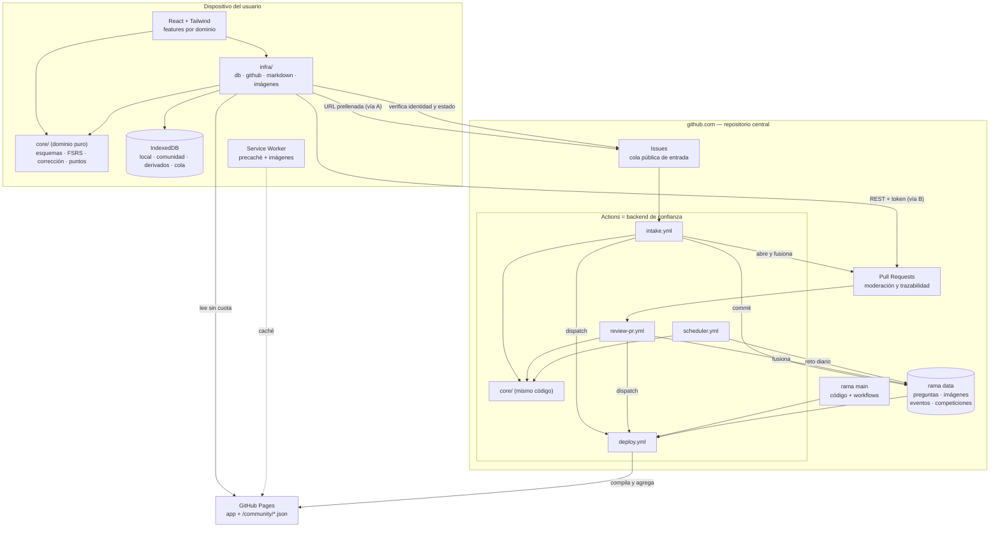
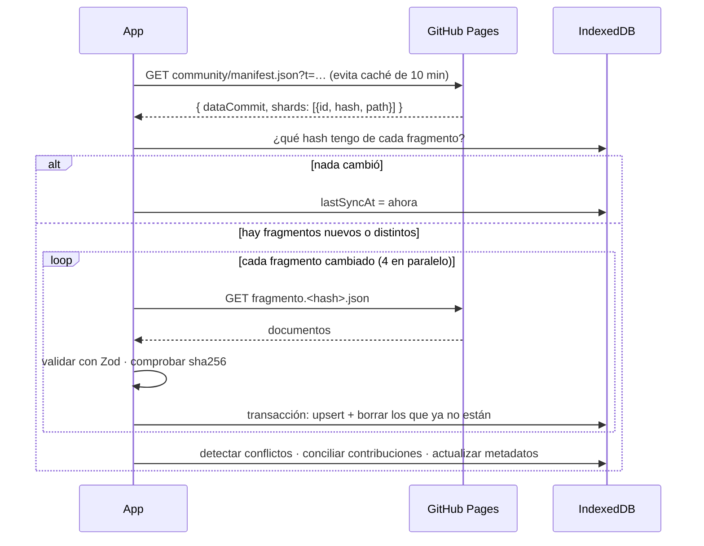
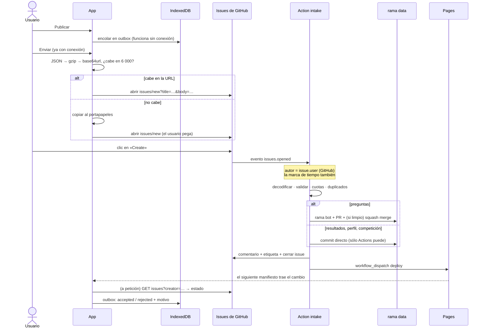
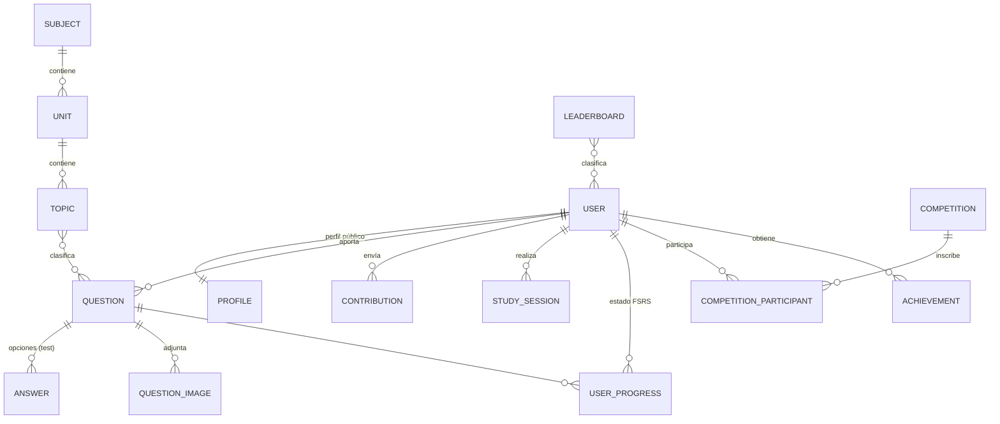

# QuestionBank · Arquitectura

> Documento vivo. Describe el diseño implementado; las limitaciones honestas están
> en [LIMITATIONS.md](LIMITATIONS.md) y el modelo de amenazas en [SECURITY.md](SECURITY.md).

## 0. La idea en un párrafo

GitHub Pages sólo sirve ficheros: no ejecuta código, no guarda nada y no sabe quién
eres. Pero GitHub sí tiene todo lo demás: **identidad** (el autor de un issue o de un
pull request lo certifica GitHub, no el cliente), **cómputo de confianza** (Actions,
con un token que el usuario no ve), **almacenamiento versionado** (Git) y **una cola de
entrada pública** (Issues y Pull Requests). QuestionBank trata a Actions como su
backend: el navegador nunca escribe datos oficiales; **propone** cambios por Issue o PR,
y el código de confianza los valida y los consolida. Los rankings no se guardan: se
**recalculan** desde el registro de eventos en cada despliegue, de modo que el cliente
no tiene ningún número que pueda alterar y cualquiera puede reproducir el resultado.

## 1. Restricciones verificadas (no supuestas)

Comprobadas el 2026-11-05 contra los servidores reales o la documentación actual de
GitHub. Cada una condiciona una decisión concreta.

| # | Hecho | Cómo se verificó | Consecuencia |
|---|---|---|---|
| 1 | `github.com/login/device/code` y `/login/oauth/access_token` responden `200` **sin** `Access-Control-Allow-Origin`, incluso con `client_id` válido | `curl` con cabecera `Origin` | **OAuth es imposible desde una web estática** sin un proxy propio, también el Device Flow y PKCE. El navegador no puede leer la respuesta |
| 2 | `api.github.com` permite CORS desde cualquier origen, incluida la cabecera `Authorization` | `curl -X OPTIONS` | Con un token ya obtenido, el navegador puede llamar a la API directamente |
| 3 | Los tokens de grano fino **no** pueden contribuir a repos públicos de los que no eres miembro; sólo los clásicos tienen ese permiso | Docs de GitHub | Un token útil implica `public_repo`, que da escritura en **todos** los repos públicos del usuario. Por eso el modo con token es opcional y no el predeterminado |
| 4 | URL prellenada de issue: 6 500 caracteres funciona; 7 000 → `500`; ≥ 10 000 → `414` | Sondeo incremental | Presupuesto de **6 000 caracteres** por URL. Lo mayor va por portapapeles (cuerpo de issue: hasta 65 536) |
| 5 | Anónimo: 60 peticiones/hora por IP, y **un `304` también gasta cuota** (54 → 51 tras 3 condicionales) | `curl` + `/rate_limit` | El polling anónimo se hace sólo a petición del usuario y de forma muy acotada. Todo lo leíble va por Pages |
| 6 | Pages responde con `ACAO: *` y `max-age=600`; `raw.githubusercontent.com` con `max-age=300` | `curl -I` | Pages no tiene límite por petición: es el canal de lectura. Los ficheros llevan su hash en el nombre y el manifiesto lleva cache-busting |
| 7 | Los eventos generados con `GITHUB_TOKEN` no lanzan workflows, salvo `workflow_dispatch` y `repository_dispatch` | Docs | Tras consolidar datos hay que **disparar el despliegue explícitamente** |
| 8 | `concurrency` admite `queue: max` (hasta 100 ejecuciones en espera); por defecto, una pendiente reemplaza a otra | Docs | Se serializan los escritores con `queue: max`, **y además** cada ejecución barre todo lo pendiente, porque la cola también puede desbordarse |
| 9 | `schedule`: mínimo 5 min, puede retrasarse o perderse con carga; se desactiva tras 60 días sin actividad en repos públicos | Docs | Los crons son barrido de seguridad, nunca la única vía. Los plazos oficiales usan marcas de tiempo de GitHub, no la hora del cron |
| 10 | Pages: 1 GB publicado, 100 GB/mes (blando), despliegue ≤ 10 min. El límite de 10 builds/hora **no aplica** a workflows propios. Prohibido SaaS comercial y transacciones sensibles | Docs | Modelo apto para comunidad educativa no comercial. Hay un plan de escala en LIMITATIONS |
| 11 | REST: 5 000/h por usuario, 1 000/h por repo con `GITHUB_TOKEN`, y 80 creaciones/min y 500/h | Docs | Cada ejecución de intake procesa como máximo 25 envíos y el siguiente barrido continúa |
| 12 | `pull_request_target` usa el workflow de la rama por defecto; `pull_request` desde forks tiene token de sólo lectura y puede requerir aprobación | Docs | La revisión usa `pull_request_target` **sin hacer checkout del PR**: los ficheros se leen como datos por la API |

## 2. Arquitectura general

Las siete preocupaciones que pediste distinguir, cada una con su mecanismo real:

| Preocupación | Solución | ¿De quién se fía? |
|---|---|---|
| **Hosting** | GitHub Pages, desplegado por Actions (`dist/` + `dist/community/`) | GitHub |
| **Almacenamiento persistente** | Rama `data` del repo central (Git); IndexedDB en el dispositivo | Git para lo oficial; el dispositivo para lo privado |
| **Autenticación** | Identidad = autor de un issue/PR, certificado por GitHub. Sin secretos. Token clásico opcional | GitHub |
| **Sincronización** | Bajada: manifiesto + fragmentos con hash (Pages, sin cuota). Subida: cola local → Issue/PR → Actions | El validador en Actions |
| **Gestión de usuarios** | `users/<login>.json`, escrito sólo por Actions a partir de un issue del propio usuario | Actions |
| **Rankings** | Función pura y determinista: registro de eventos → clasificaciones, ejecutada en cada despliegue | Actions + reproducible por terceros |
| **Competiciones** | Asíncronas. Actions elige las preguntas, corrige y ordena; los plazos usan el reloj de GitHub | Actions |

### Decisión de topología: un repositorio, dos ramas

| Opción estudiada | Simplicidad | Seguridad | Escala | Fricción usuario | Veredicto |
|---|---|---|---|---|---|
| Repo central con JSON, escritura directa | Alta | **Nula**: exige dar acceso de escritura a todos | Media | Baja | Descartada |
| Repos individuales de cada usuario | Baja | Media | Alta | **Alta**: hay que descubrirlos y agregarlos | Descartada |
| Forks + PR como única vía | Media | Alta | Alta | **Alta**: exige token `public_repo` | Vía secundaria |
| Issue → Action → PR | Alta | Alta: el contenido es sólo datos | Alta | **Mínima**: un clic en GitHub, sin token | **Vía principal** |
| Dos repos (código y datos) | Baja: exige un PAT secreto entre repos | Alta | Alta | Igual | Descartada de momento |

**Elegido:** un solo repo con **`main`** (código, workflows) y **`data`** (rama huérfana
sólo con contenido comunitario). Ventajas decisivas:

- Un PR contra `data` no puede tocar código ni workflows: la rama no los contiene y los
  workflows se ejecutan siempre desde `main`.
- Sin secretos entre repos: basta el `GITHUB_TOKEN`.
- El historial de contenido no contamina el de código y `main` se puede proteger sin
  bloquear a los bots.
- Sigue valiendo «push a `main` despliega».

### Dos vías de publicación, una sola validación

```
Vía A (por defecto, sin token)            Vía B (opcional, con token clásico)
  App → URL de issue prellenada             App → fork + rama + commit + PR (REST)
  Usuario: un clic en «Create»              Sin clics adicionales
  Action crea un PR desde bot/rama          PR desde el fork del usuario
              └──────────────┬───────────────────┘
                     validate-contribution (core)
                     ├─ limpio → merge automático (configurable)
                     └─ dudas  → etiqueta needs-review → revisión humana
```

Datos que no son contenido (resultados, entradas de competición, perfil) van siempre por
Issue, sea prellenado o por API. No tiene sentido abrir un PR por cada sesión de estudio.

## 3. Diagrama de componentes



**Regla de oro de capas:** `core/` no conoce el DOM, IndexedDB ni la red, y se ejecuta
idéntico en el navegador y en Actions. Así el cliente puede *predecir* una corrección o
unos puntos para dar feedback inmediato, pero el valor oficial lo calcula el mismo código
en un entorno que el usuario no controla.

## 4. Flujo de sincronización

### Bajada (sin cuota, sin token, incremental)



- **Incremental:** los fragmentos llevan hash de contenido. Una pregunta nueva sólo
  provoca descargar 1 de los 16 cubos de esa asignatura.
- **Atómica:** el fragmento se aplica en una transacción y su hash se guarda en la misma;
  un corte de red nunca deja un estado a medias.
- **Tolerante:** un documento inválido se descarta y se registra; no rompe el resto.

### Subida (vía A, sin token)



La vía B usa la misma cola, pero sin clics: envía en segundo plano al volver la conexión.

### Conflictos y duplicados

| Situación | Dónde se detecta | Resolución |
|---|---|---|
| Edición local con `baseRev` obsoleto | Cliente (en sync) y validador | Se marca `conflict`. La UI compara y deja elegir: usar la comunitaria, reescribir la mía sobre la nueva o guardarla como pregunta nueva |
| Pregunta idéntica | Cliente (al editar) y validador | Huella SHA-256 sobre texto normalizado → rechazo |
| Pregunta casi idéntica | Cliente y validador | Jaccard sobre 2-shingles ≥ 0,85 → aviso en cliente, `needs-review` en el PR |
| Asignatura o tema repetido | Cliente (al sincronizar y publicar) y validador | Nombre normalizado, único por padre: se adoptan los identificadores del existente |
| Reenvío del mismo lote | Validador | Idempotente por id de evento y `batchId` |

## 5. Modelo de datos

Definición completa con esquemas Zod en `core/schema/`; detalle en
[DATA-MODEL.md](DATA-MODEL.md). Tres capas que nunca se mezclan:

| Capa | Dónde vive | ¿Quién escribe? | Si se pierde… |
|---|---|---|---|
| **Local** | IndexedDB `l*`, `attempts`, `progress`, `sessions`, `drafts`, `outbox` | El usuario | Se pierde (por eso hay exportación y `storage.persist()`) |
| **Comunitaria** | Rama `data`; réplica en IndexedDB `c*` | Sólo Actions, tras validar | Se vuelve a descargar |
| **Derivada** | `dist/community/*` (no versionada); réplica en IndexedDB `d*` | Sólo el build | Se recalcula desde los eventos |



| Entidad | Capa | Notas |
|---|---|---|
| `User` | Comunitaria | `{login, githubId}`. Viene de GitHub, nunca del cliente |
| `Profile` | Comunitaria + derivada | `displayName` y `bio` los edita el dueño; lo demás se calcula |
| `Subject` / `Unit` / `Topic` | Local y comunitaria | UUID estable. Un documento por asignatura para diffs legibles |
| `Question` / `Answer` / `QuestionImage` | Local y comunitaria | UUID estable, `rev` incremental, contenido en Markdown |
| `StudySession` / `UserProgress` | Local | Lo oficial se deriva de los eventos publicados |
| `Competition` / `CompetitionParticipant` | Comunitaria + derivada | La clasificación se recalcula |
| `Achievement` / `Leaderboard` | Derivada | Sin fichero editable: función de los eventos |
| `Contribution` | Local + comunitaria | Estado de cada envío en el cliente; rastro en Issue y PR |
| `SyncMetadata` | Local | Hash por fragmento, `lastSyncAt`, registro |

**Versionado:** todo documento lleva `schemaVersion`. El validador acepta versiones
anteriores y las migra (`core/schema/migrations.ts`); rechaza las futuras. IndexedDB usa
versionado de Dexie. Fechas siempre ISO 8601 en UTC.

**Formato de contenido: Markdown, no HTML ni JSON de editor.** Se revisa en el diff de un
PR, es compacto y no permite HTML crudo. El editor ofrece barra de formato, atajos y
previsualización. Es la desviación deliberada frente a un editor WYSIWYG tipo TipTap
(≈ 100 KB más y un formato opaco en los PR).

## 6. Estructura de carpetas

```
questionbank/
├─ .github/workflows/   ci · deploy · intake · review-pr · scheduler
├─ core/                Dominio puro, compartido entre navegador y Actions
│  ├─ schema/           Zod: pregunta, temario, evento, competición, perfil, manifiesto, envío
│  ├─ questions/        Corrección, normalización, duplicados, referencias a imágenes
│  ├─ taxonomy/         Operaciones sobre la jerarquía
│  ├─ srs/              FSRS (repetición espaciada)
│  ├─ study/            Selección de preguntas para cada modo
│  ├─ scoring/          Reglas de puntos, agregador, logros, niveles, integridad
│  ├─ competitions/     Selección con semilla, clasificaciones, cuadros de torneo
│  ├─ submissions/      Sobre del envío: codificar, decodificar, presupuestos
│  ├─ validation/       Reglas de aceptación de aportaciones
│  └─ util/             Hash, RNG con semilla, tiempo, base64url, UUID
├─ tools/               Node: lo que corre en Actions
│  ├─ build-community.ts  rama data → dist/community (incluye rankings)
│  ├─ actions/          intake · review-pr · scheduler · main (entrada de los workflows)
│  └─ lib/              Cliente de GitHub, almacén de datos, aplicadores
├─ src/                 La PWA
│  ├─ app/              Router, layout, proveedores
│  ├─ features/         dashboard · explore · bank · editor · taxonomy · study · stats
│  │                    sync · account · profile · leaderboards · competitions · settings
│  ├─ infra/            db · github · markdown · images · crypto · pwa
│  └─ ui/               Kit de componentes
├─ tests/               Espejo de core/, tools/ y src/
├─ public/              Iconos
└─ docs/
```

**Rama `data`:**

```
taxonomy/<subjectId>.json              Asignatura con sus unidades y temas
questions/<subjectId>/<questionId>.json
images/<sha256>.<webp|png|jpg>         Direccionadas por contenido
users/<login>.json                     Perfil (lo escribe Actions)
events/<yyyy>/<mm>/<login>.jsonl       Respuestas aceptadas, sólo añadir
system-events/<yyyy>/<mm>.jsonl        Preguntas aprobadas, etc.
competitions/<id>/competition.json
competitions/<id>/entries/<login>[.r<ronda>].json
moderation/{banned,hidden,trusted}.json
```

## 7. Estrategia de autenticación

**Tres conceptos que no se confunden:**

| Concepto | Qué es | ¿Quién lo garantiza? |
|---|---|---|
| **Identidad autenticada** | «Este envío es de `@login`» | GitHub, como autor del issue/PR. Actions lee `issue.user`, nunca un campo del cuerpo |
| **Perfil público** | Nombre visible, biografía, avatar | El dueño lo edita con un issue propio; Actions valida y sanea |
| **Datos verificables** | Puntos, precisión, logros, nivel | Nadie los escribe: se derivan de los eventos validados |

**Conexión sin token («Conectar con GitHub»)**

1. La app genera un `nonce` y abre `issues/new` con un título `[QB:connect] <nonce>`.
2. El usuario, con su sesión de GitHub, pulsa *Create*.
3. La app consulta los issues recientes del repo con una petición anónima, encuentra el
   `nonce` y lee `user.login`, `user.id` y `user.avatar_url`. Lo devuelve **GitHub**.
4. Action registra `users/<login>.json` y cierra el issue.

No hay secreto alguno. Si alguien manipula su cliente para mostrarse como otro, sólo se
engaña a sí mismo: **ningún dato oficial depende de esa sesión local**, porque los envíos
se atribuyen por el autor real del issue.

**Por qué no OAuth:** ver restricción 1. La única forma sería un proxy propio, que
descartaste expresamente. Si algún día se relaja esa norma, bastaría un Cloudflare Worker
sin estado ni secretos para el Device Flow; no está implementado.

**Modo con token (opcional).** Permite publicar sin clics y sin límite práctico de
imágenes. Requiere token clásico `public_repo` (restricción 3), que el usuario crea y pega:

- **Nunca** en el bundle ni en `localStorage`.
- Por defecto, sólo en memoria: se pierde al cerrar la pestaña.
- Con «recordar en este dispositivo», se cifra con AES-GCM y una `CryptoKey`
  **no extraíble** en IndexedDB. Protege frente a la copia del perfil del navegador, no
  frente a XSS activo; contra eso están la CSP y el saneamiento (SECURITY.md).
- La CSP limita `connect-src` a la propia página y a `api.github.com`.
- La UI recomienda caducidad corta y explica el alcance real del permiso.

## 8. Estrategia de almacenamiento

| Dato | Almacén | Motivo |
|---|---|---|
| Preguntas y temario oficiales | Git, rama `data` | Historial, revisión, sin BD externa |
| Lectura de datos | Pages, JSON con hash | Sin cuota de API, CDN, misma procedencia |
| Datos del dispositivo | IndexedDB con Dexie | Transacciones, índices multi-entrada, migraciones |
| Binarios locales | IndexedDB (`Blob`) | Hasta que se publican |

### Imágenes: alternativas estudiadas

| Opción | Problema | Veredicto |
|---|---|---|
| Base64 dentro del JSON | Infla un 33 % y cada cambio reescribe el fragmento | Sólo para transporte en un issue |
| Adjuntos de issue (`user-attachments`) | Requiere arrastrarlas a mano; URL opaca fuera de control | Descartada |
| GitHub Releases | Sin CORS (redirección a otro dominio), caché opaca en SW | Reservada como plan de escala |
| Git LFS | Cuota muy limitada y Pages no lo sirve | Descartada |
| **Fichero en la rama `data`, direccionado por SHA-256, servido por Pages** | Crece el repo; límite de 1 GB | **Elegida** |

El cliente reduce cada imagen a WebP (máx. 1 600 px) antes de guardarla; en la vía sin token,
las vuelve a reducir hasta que quepan en el issue (1 024, 768 y 512 px). Pasar por el canvas
elimina también los metadatos, como el GPS de una foto. El validador comprueba los *magic bytes*, el tamaño y que el nombre coincida
con el hash. **SVG está prohibido** porque puede ejecutar scripts. El Markdown sólo admite
`qbimg:<sha256>`: una URL externa se rechaza, lo que elimina también los píxeles de rastreo.

## 9. Estrategia de rankings

```
events/*.jsonl ─┐
questions/*    ─┼─► aggregate() (core/scoring, función pura) ─► leaderboards · profiles
competitions/* ─┘                                              achievements · questionStats
```

**Qué se valida de verdad en servidor:** la corrección (se recalcula desde la pregunta;
**el cliente nunca envía «acerté»**, sólo qué opciones marcó), el autor, la hora de
recepción, los duplicados y las cuotas.

**Sistema de puntos** (`core/scoring/rules.ts`):

| Acción | Puntos | Freno contra abusos |
|---|---|---|
| Acierto en test | 2 · 3 · 5 · 8 · 12 según dificultad | Por pregunta: 100 %, 50 %, 25 % y después 0; mínimo 20 h entre premios. Máx. 200 pts/día |
| Fallo | 0 | — |
| Tu propia pregunta | 0 | Autoría comprobada en servidor |
| Desarrollo autoevaluado | 1 | Máx. 20/día: no verificable, no cuenta para precisión |
| Sesión completa (≥ 10 válidas) | 5 | Máx. 3/día |
| Pregunta aprobada | 15 | Máx. 5/día |
| Otros usan tu pregunta | +1 por usuario distinto | Máx. 30 por pregunta y 50/día |
| Participar en competición | 10 | Una entrada por competición |
| Podio / duelo ganado | 30 · 20 · 10 / 15 | Exige un mínimo de participantes |
| Racha de 3 · 7 · 30 días | 5 · 15 · 50 | Día válido = ≥ 5 respuestas; se cobra una vez por racha |

**Clasificaciones:** global, semanal, mensual, por asignatura, por aportaciones, por
rendimiento (límite inferior de Wilson, para que 10/10 no gane a 950/1000) y por
competiciones. El periodo se asigna con la **hora de recepción de GitHub**, no con la que
declara el cliente.

**Integridad:** respuestas de < 500 ms se descartan; `at` futuro o con más de 14 días de
antigüedad, también. Una mediana < 1,5 s con ≥ 90 % de acierto en ≥ 30 respuestas marca la
cuenta como sospechosa y la excluye hasta revisión.

**Honestidad:** esto impide **escribir** puntos y hace toda trampa pública y auditable,
pero **no impide contestar con la solución delante**: el banco es público, respuestas
incluidas. Sin servidor que oculte las respuestas, un ranking así no puede ser una
credencial. Es el límite de la arquitectura y la UI lo dice (LIMITATIONS.md).

## 10. Estrategia de competiciones

| Paso | Mecanismo | Lo garantiza |
|---|---|---|
| Crear | Issue `[QB:competition-create]` | Autor: GitHub |
| Elegir preguntas | Action, con semilla `sha256(id + commit de data)` | El creador no conoce la selección de antemano |
| Código e invitación | Action genera código corto y hace `@mención` en un comentario | **GitHub envía la notificación real** |
| Unirse | Código o enlace; basta con enviar la entrada | — |
| Jugar | Cliente, sin conexión si está descargada; temporizador con reloj de pared | Cliente (ver límite) |
| Entregar | Issue `[QB:competition-entry]` con las opciones marcadas | Hora de recepción: GitHub |
| Corregir y ordenar | Action en el build: función pura | Reproducible |

**Tipos:** duelo (2), grupo (N), torneo (eliminatoria con cuadro determinista derivado de
la semilla, rondas asíncronas por ventana y exenciones), reto diario y semanal (los crea un
cron). Sólo usan preguntas tipo test, porque el desarrollo no se puede corregir sin
autoevaluación.

**Tiempo real: no es viable.** Sin servidor no hay WebSocket; signaling por issues tiene
una latencia de 30–120 s y WebRTC requeriría STUN externo o intercambio manual de SDP. La
alternativa compatible es la que se implementa: asíncrona, con clasificación que se
actualiza en cada despliegue (minutos).

**Lo que el servidor garantiza y lo que no:** garantiza el autor, la ventana de entrega, una
sola entrada por persona y la corrección. **No garantiza** la duración por intento, que la
mide el cliente y se marca como «declarada» (LIMITATIONS.md).

## 11. Limitaciones técnicas

Resumen; el detalle y las alternativas están en [LIMITATIONS.md](LIMITATIONS.md).

1. **Latencia de escritura de 1–3 minutos**: Action + despliegue. Hay estado intermedio en la UI.
2. **Un clic en GitHub por envío** en la vía sin token: es el coste de no tener secretos.
3. **Sin OAuth** (restricción 1).
4. **Antitrampas limitado** (§ 9): se impide falsear puntos, no consultar respuestas.
5. **Los resultados publicados son públicos**: el registro está en un repo público. Publicar
   es opcional y explícito; estudiar sin publicar no envía nada.
6. **Git no olvida**: retirar contenido lo oculta, pero exige reescribir historial para borrarlo.
7. **Escala:** hasta 1 GB publicado y ≈ 10⁴–10⁵ preguntas. Plan de escala documentado.
8. **Sin notificaciones push** salvo las propias de GitHub (`@mención`).
9. **Progreso entre dispositivos:** exportar e importar. No hay nube privada.

## 12. Trabajo previo analizado

En este directorio existe `QB Fisica/`, un banco de preguntas de Física IB para un solo
usuario. **No se ha modificado.** De él se toman ideas probadas: atajos de teclado (A–D,
Enter, Espacio), autoevaluación de desarrollo en tres niveles y «cambiar mi respuesta».
**Sus 1 636 preguntas no se usan como datos iniciales:** son exámenes del IB con derechos de
autor (su propio `LEEME.md` lo advierte) y este repo es público. Por eso toda aportación
exige aceptar una licencia y declarar su origen.

## 13. Plan por fases

| Fase | Entrega | Criterio para pasar a la siguiente |
|---|---|---|
| 1 Fundación | Vite, PWA, tema, esquemas, IndexedDB, shell | Instalable, offline, tests verdes |
| 2 Banco | Temario, editor, imágenes, listado y filtros | Crear y recuperar preguntas tras recargar |
| 3 Estudio | Práctica, examen, repaso, FSRS, estadísticas | Sesión completa sin conexión; reanuda tras cerrar |
| 4 Sync | Build comunitario, intake, PR, cola, conflictos | Pipeline probado con eventos simulados |
| 5 Usuarios | Conexión, token, perfiles | Identidad verificada, perfil público |
| 6 Gamificación | Agregador, logros, rankings | Reproducible y resistente a abuso en tests |
| 7 Competiciones | Duelo, grupo, torneo, retos | Ciclo completo simulado |
| 8 Producción | Seguridad, accesibilidad, rendimiento, despliegue | Checklist; E2E real al desplegar |
